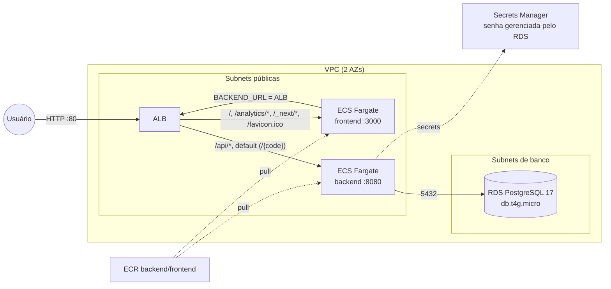

# Deploy na AWS (ECS Fargate + RDS)

Terraform em [`infra/terraform/`](../infra/terraform). Ambiente único, foco em baixo custo e simplicidade.

## Arquitetura



| Arquivo | Conteúdo |
|---|---|
| `versions.tf` / `providers.tf` | Versões fixadas, backend S3 (config parcial), `default_tags` |
| `network.tf` | VPC (módulo `terraform-aws-modules/vpc`), security groups |
| `ecr.tf` | Repositórios com scan on push e lifecycle (últimas N imagens) |
| `alb.tf` | ALB, target groups, listener HTTP e regras por path |
| `ecs.tf` | Cluster, task definitions, services, logs, IAM de execução |
| `rds.tf` | PostgreSQL 17 com senha gerenciada no Secrets Manager |

Roteamento do ALB: `/api/*` → backend; `/`, `/analytics/*`, `/_next/*`, `/favicon.ico` → frontend; qualquer outro path (short codes) → backend.

Variáveis de ambiente:

- Backend: `DB_URL` (endpoint do RDS), `APP_BASE_URL` e `APP_FRONTEND_URL` = `http://<dns do ALB>`; `DB_USER`/`DB_PASSWORD` injetados via `secrets` do ECS a partir do secret gerenciado pelo RDS.
- Frontend: `BACKEND_URL` = `http://<dns do ALB>`. O fetch server-side sai pela internet e volta pelo ALB; é a opção mais simples (sem Service Connect/Cloud Map).

## Decisões e trade-offs (custo)

- **Sem NAT Gateway:** tasks Fargate ficam em subnets públicas com IP público (necessário para puxar imagens do ECR e ler o Secrets Manager). A entrada é restrita por security group (só o ALB alcança as portas das tasks). Economiza ~US$ 32/mês por NAT.
- **Só HTTP:** sem domínio/certificado. Os links gerados usam o DNS do ALB.
- **RDS single-AZ, db.t4g.micro:** sem failover automático. Criptografado, sem acesso público, porta 5432 aberta apenas ao SG do backend. Backups de 7 dias.
- **Proteções do banco:** `db_deletion_protection = true` e `db_skip_final_snapshot = false` por padrão. Para destruir, altere as duas variáveis (ver abaixo).
- **ARM64 (Graviton):** Fargate ARM é mais barato e builda nativamente em Macs Apple Silicon. Todas as imagens devem ser `linux/arm64`.
- **1 task por serviço**, sem autoscaling. Circuit breaker com rollback habilitado.
- **ECR com `force_delete`:** imagens são reconstruíveis; permite `destroy` sem esvaziar o repositório.
- **Health check do frontend em `/`:** a página consulta o backend, então o frontend só fica saudável com o backend no ar.

## Pré-requisitos

- Terraform `~> 1.10`, AWS CLI v2 autenticada, Docker com `buildx`.

## Passo a passo

```bash
export AWS_REGION=us-east-1
cd infra/terraform
```

1. **Bucket de state** (uma vez; nome globalmente único):

   ```bash
   BUCKET=<seu-bucket>-tfstate
   aws s3api create-bucket --bucket "$BUCKET" --region "$AWS_REGION"
   aws s3api put-bucket-versioning --bucket "$BUCKET" --versioning-configuration Status=Enabled
   ```

   Para regiões diferentes de `us-east-1`, adicione `--create-bucket-configuration LocationConstraint=$AWS_REGION`.

2. **Configuração:**

   ```bash
   cp backend.hcl.example backend.hcl          # ajuste bucket/region
   cp terraform.tfvars.example terraform.tfvars
   terraform init -backend-config=backend.hcl
   ```

3. **ECR primeiro** (as services precisam de imagens para subir):

   ```bash
   terraform apply -target=aws_ecr_repository.app
   ```

4. **Build e push das imagens (linux/arm64):**

   ```bash
   ACCOUNT=$(aws sts get-caller-identity --query Account --output text)
   REGISTRY=$ACCOUNT.dkr.ecr.$AWS_REGION.amazonaws.com
   aws ecr get-login-password | docker login --username AWS --password-stdin "$REGISTRY"

   for app in backend frontend; do
     docker buildx build --platform linux/arm64 \
       -t "$REGISTRY/url-shortener/$app:latest" --push ../../$app
   done
   ```

5. **Apply completo:**

   ```bash
   terraform apply
   ```

   O primeiro apply leva ~10 min (RDS). O backend roda as migrations do Flyway ao subir.

6. **Smoke test:**

   ```bash
   URL=$(terraform output -raw app_url)
   curl -s -X POST "$URL/api/shorten" -H 'Content-Type: application/json' -d '{"url":"https://example.com"}'
   curl -i "$URL/<shortCode>"            # 301 para https://example.com
   curl -s "$URL/api/stats/<shortCode>"
   open "$URL"                           # lista; /analytics/<shortCode> para analytics
   ```

## Atualizar uma versão

Com tag fixa (`latest`), faça push da nova imagem e force um novo deploy:

```bash
aws ecs update-service --cluster url-shortener --service backend --force-new-deployment
```

Alternativa: publicar com uma tag nova (ex.: SHA do commit) e rodar `terraform apply -var image_tag=<sha>`.

Logs: CloudWatch em `/ecs/url-shortener/backend` e `/ecs/url-shortener/frontend`.

## Destroy

```bash
terraform apply -var db_deletion_protection=false -var db_skip_final_snapshot=true
terraform destroy -var db_deletion_protection=false -var db_skip_final_snapshot=true
```

Mantendo `db_skip_final_snapshot = false`, o RDS gera o snapshot `url-shortener-final` (remova-o manualmente se não precisar). O bucket de state não é gerenciado por este Terraform.

## Próximos passos

- **HTTPS:** domínio no Route 53, certificado ACM, listener 443 e redirect 80→443; atualizar `APP_BASE_URL`/`APP_FRONTEND_URL` para o domínio.
- **CI/CD:** GitHub Actions com OIDC (role IAM sem chaves estáticas) para build/push no ECR e deploy com tag por commit.
- **Autoscaling:** Application Auto Scaling nas services (CPU/requests por target); RDS Multi-AZ quando houver requisito de disponibilidade.
- **Rede privada:** tasks em subnets privadas com NAT ou VPC endpoints, e `BACKEND_URL` via Service Connect em vez do ALB público.
